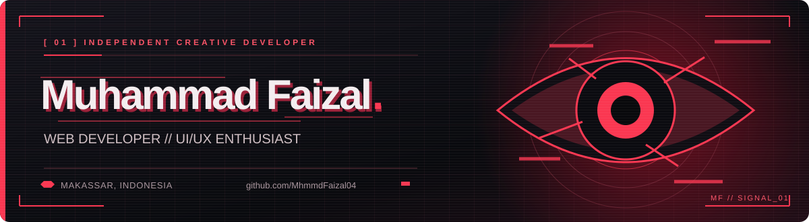

  

   

  <strong>Building thoughtful digital experiences, from idea to interface.</strong>
   
  Web development · Interface design · Creative technology

    

  <a href="https://porto-zal.vercel.app">Portfolio</a> &nbsp;·&nbsp;
  <a href="https://github.com/MhmmdFaizal04?tab=repositories">Projects</a> &nbsp;·&nbsp;
  <a href="mailto:faisalxbaim@gmail.com">Contact</a>

    

  
  
  

 

## About me

Saya **Muhammad Faizal**, freelancer dan web developer dari Makassar, Indonesia. Saya tertarik pada cara **desain UI/UX dan teknologi** bekerja bersama untuk membuat produk digital yang jelas, nyaman digunakan, dan punya karakter.

Saya mengerjakan proyek web, mengeksplorasi desain antarmuka, dan membagikan eksperimen saya secara terbuka di GitHub. Latar belakang saya di editing dan konten kreatif ikut membentuk cara saya melihat detail visual serta pengalaman pengguna.

## What I do

| Fokus | Pendekatan |
| :--- | :--- |
| **Web development** | Membangun pengalaman web yang responsif dan mudah digunakan. |
| **UI/UX design** | Memikirkan struktur, keterbacaan, alur, dan detail antarmuka. |
| **Creative work** | Menggabungkan desain, editing, dan teknologi menjadi karya digital. |

## Selected work

| Project | Overview | Links |
| :--- | :--- | :--- |
| **SharkMotion** | Eksplorasi editor motion graphics dan video berbasis browser. | [Code](https://github.com/MhmmdFaizal04/SharkMotion) · [Live](https://shark-motion-studio.vercel.app) |
| **Usman-bot** | Proyek web berbasis TypeScript. | [Code](https://github.com/MhmmdFaizal04/Usman-bot) · [Live](https://usman-bot.vercel.app) |
| **Portfolio** | Situs personal untuk memperkenalkan karya dan pengalaman saya. | [Code](https://github.com/MhmmdFaizal04/Portofolio-Mhmmd-Faizal) · [Live](https://porto-zal.vercel.app) |

Lebih banyak eksperimen dan proyek tersedia di <a href="https://github.com/MhmmdFaizal04?tab=repositories">semua repositori saya →</a>

## Toolkit

**Development**

  
  
  
  
  
  

**Design & workflow**

  
  
  
  
  

## GitHub analytics

  
  

   

  

### Contribution graph

  

 

## Let's connect

Terbuka untuk diskusi tentang proyek web, desain antarmuka, dan kolaborasi kreatif.

**[Email](mailto:faisalxbaim@gmail.com)** &nbsp;·&nbsp; **[Instagram](https://www.instagram.com/zallvisual/)** &nbsp;·&nbsp; **[YouTube](https://www.youtube.com/@ZallXDYT)** &nbsp;·&nbsp; **[GitHub](https://github.com/MhmmdFaizal04)**
