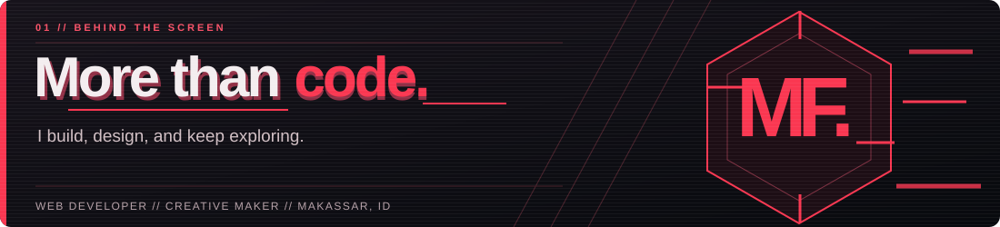
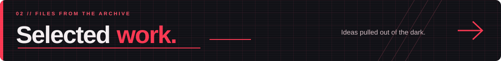
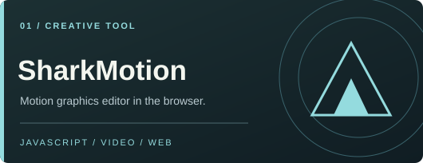
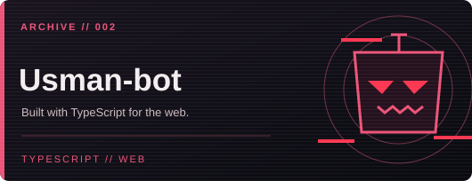
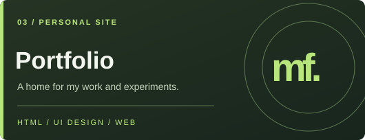

  

   

  <strong>Building thoughtful digital experiences, from idea to interface.</strong>
   
  Web development · Interface design · Creative technology

    

  <a href="https://porto-zal.vercel.app">Portfolio</a> &nbsp;·&nbsp;
  <a href="https://github.com/MhmmdFaizal04?tab=repositories">Projects</a> &nbsp;·&nbsp;
  <a href="mailto:faisalxbaim@gmail.com">Contact</a>

    

  
  
  

 

Saya membangun pengalaman web dengan perhatian pada <strong>fungsi, tampilan, dan pengalaman pengguna.</strong> Sebagai freelancer dari Makassar, saya menggabungkan pengembangan web, eksplorasi UI/UX, dan latar belakang kreatif dalam proyek yang saya kerjakan.

### 01 / What I do

> **DEVELOP** &nbsp; — &nbsp; Web yang responsif dan mudah digunakan.  
> **DESIGN** &nbsp;&nbsp;&nbsp;&nbsp;&nbsp; — &nbsp; Struktur, alur, dan detail UI/UX yang terasa tepat.  
> **CREATE** &nbsp;&nbsp; — &nbsp; Eksperimen visual, editing, dan karya digital.

 

 

  
  
  

  <a href="https://shark-motion-studio.vercel.app">SharkMotion ↗</a> &nbsp;·&nbsp;
  <a href="https://usman-bot.vercel.app">Usman-bot ↗</a> &nbsp;·&nbsp;
  <a href="https://porto-zal.vercel.app">Portfolio ↗</a> &nbsp;·&nbsp;
  <a href="https://github.com/MhmmdFaizal04?tab=repositories">All repositories ↗</a>

 

## Toolkit

**Development**

  
  
  
  
  
  

**Design & workflow**

  
  
  
  
  

## GitHub analytics

  
  

   

  

### Contribution graph

  

 

## Let's connect

Terbuka untuk diskusi tentang proyek web, desain antarmuka, dan kolaborasi kreatif.

**[Email](mailto:faisalxbaim@gmail.com)** &nbsp;·&nbsp; **[Instagram](https://www.instagram.com/zallvisual/)** &nbsp;·&nbsp; **[YouTube](https://www.youtube.com/@ZallXDYT)** &nbsp;·&nbsp; **[GitHub](https://github.com/MhmmdFaizal04)**
